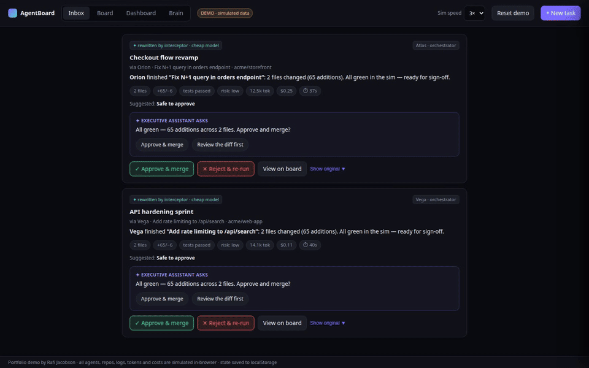
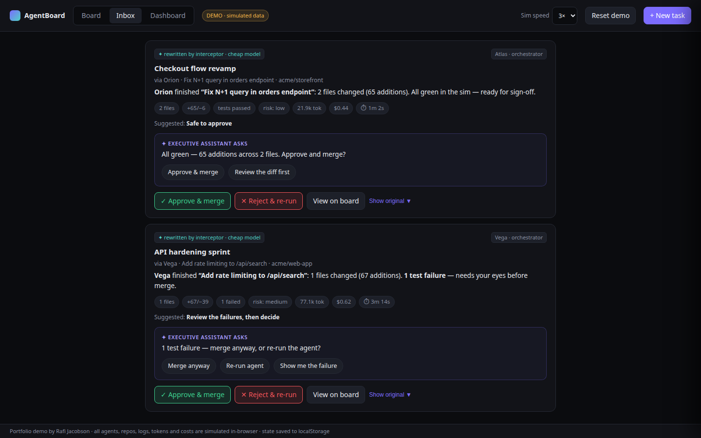
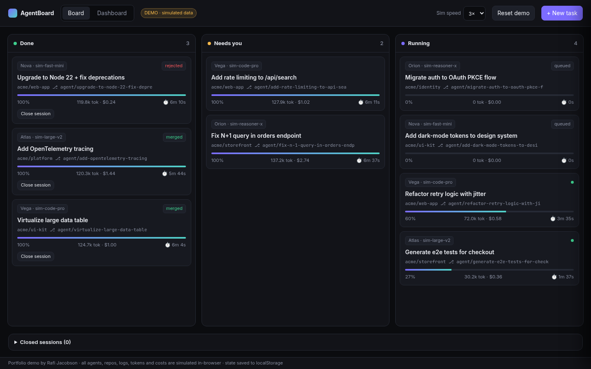
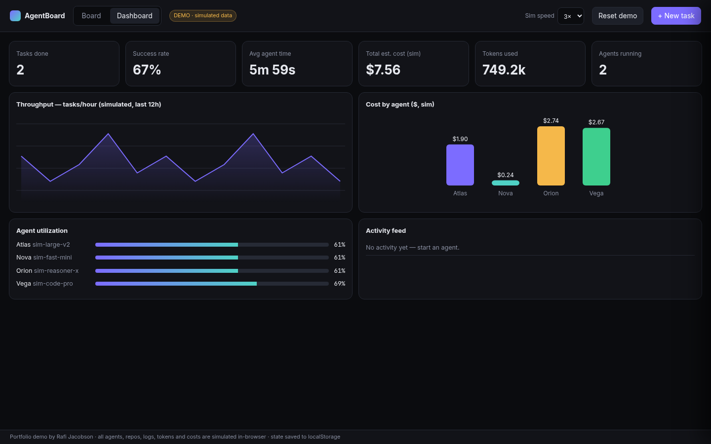

# AgentBoard — The IDE Replacement

**Your agents need a manager. This is the inbox.**

▶️ **Live demo:** https://rafijac.github.io/agentboard/ — no setup, runs in your browser. All agents, repos, logs, token counts and costs are simulated.

An original, single-file portfolio demo by Rafi Jacobson. AgentBoard is the IDE replacement for the agent era: you don't write code anymore — you manage the agents that do. A board for every session, and an inbox that only shows you the sessions that truly need you.

## The inbox — only what needs you

The inbox is the default view — it's what you land on. Most agent tools bury you in logs. The inbox does the opposite: only orchestrator sessions land here, only when they truly need a human. Each item is rewritten into a concise visual card — summary, fact chips, suggested action, Approve / Reject — plus "show original" for the full agent log. And instead of dumping a log on you, the executive assistant asks a targeted question with one-tap answers: *"1 test failure — merge anyway, or re-run the agent?"*

## The wiki brain — the executive assistant's memory

Before anything reaches your inbox, the executive assistant checks the wiki brain — a living knowledge graph built from your past answers, decisions, and project context — and tries to resolve the session itself. Only what it can't answer with confidence becomes an inbox item. Explore it live in the demo's **Brain** tab: an interactive 3D graph of clusters, nodes, and edges — drag to rotate, scroll to zoom, hover a node — plus what the brain has learned from you so far.

## The interceptor — a cheap model in front of you

A simulated cheap-model layer sits between the agents and you. When a session needs attention it first tries to handle it itself — in this simulation it's configured to resolve ~45% of interruptions on its own (marked ✦, never reaching you). Otherwise it rewrites the agent's long-winded log into the concise inbox card. Worker sessions never surface directly; their needs escalate through their orchestrator.

## The board & dashboard

**Board** — every session collated: Done | Needs you | Running. Orchestrator sessions and their worker subagents, drag-and-drop between columns.

**Dashboard** — KPIs (tasks done, success rate, avg time, cost, tokens, intercepted, needs-you), throughput chart, cost-by-agent chart, agent utilization, activity feed. The inbox is the default view — open the board directly with `index.html#board`, the dashboard with `index.html#dashboard`, the brain with `index.html#brain`.

## Run it yourself

Open `index.html` in any modern browser. No build step and no dependencies (the Inter/JetBrains Mono fonts come from Google Fonts and are optional).

## Features

- Approve moves a card to Done (merged); reject archives a rejected copy in Done and re-runs the agent
- "Close session" on a Done card moves it to the collapsible Closed sessions area below the board, where it can be reopened
- Task cards: agent + model, worker/orchestrator tag, parent session, repo/branch, progress, tokens, est. cost, elapsed time, ✦ marker when the interceptor touched it
- New-task modal (press `n`), optional auto-start
- Side panel: live streaming agent log, diff summary, Approve & merge / Reject & re-run
- Simulated agents advance on timers (1×/3×/8× speed)
- State persisted in localStorage; "Reset demo" restores seed data
